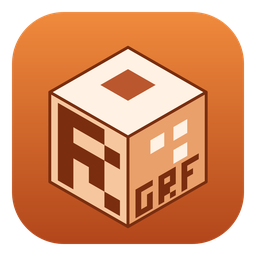
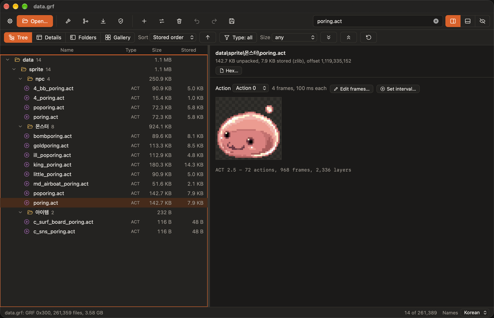
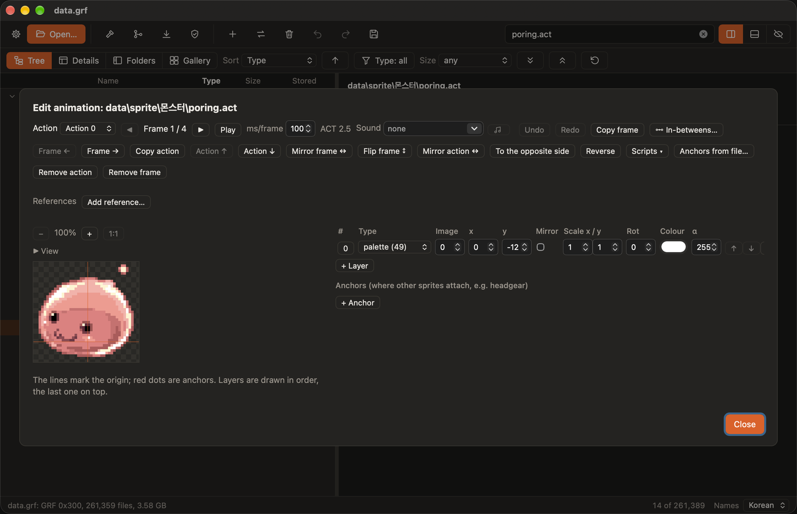
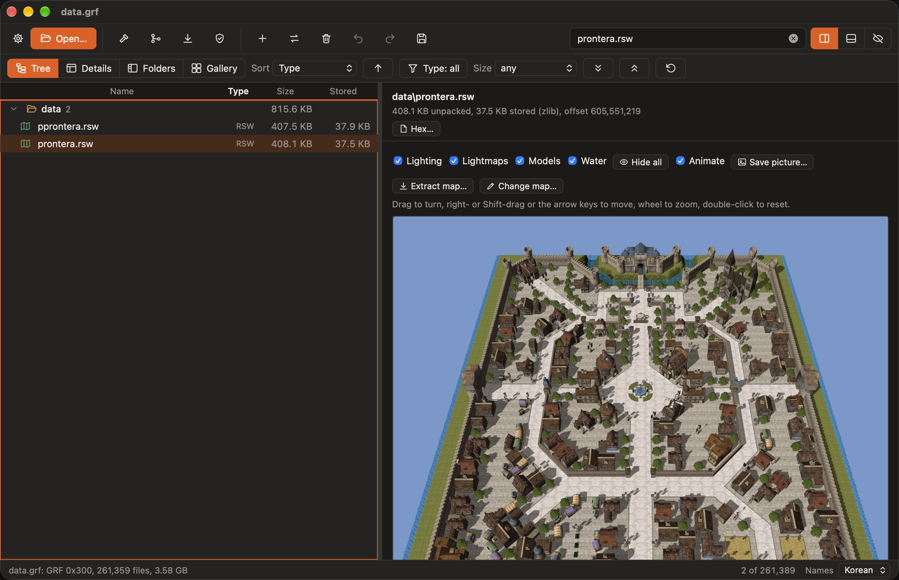

# RustyGRF

<p align="center">
  
</p>

> _One tool for Ragnarok Online **GRF** (Gravity Resource File) archives, sprites, animations, palettes and maps._

A free, open-source desktop app, command-line tool and MCP server for Ragnarok Online client files. Open, check, edit, build, merge and encrypt archives, and edit what is inside them, on macOS, Windows and Linux.

**macOS · Windows · Linux** · **Rust + Tauri 2** · **MIT or Apache-2.0** · **v0.2.3 (beta)**

<p align="center">
  <a href="https://github.com/kxdrsrt/RustyGRF/releases/latest"></a>
  <a href="https://github.com/kxdrsrt/RustyGRF/actions/workflows/ci.yml"></a>
  <a href="#license"></a>
</p>

<p align="center">
  <a href="https://github.com/sponsors/kxdrsrt"></a>
  <a href="https://ko-fi.com/kadirsert"></a>
  <a href="https://opencollective.com/kxdrsrt"></a>
  <a href="https://www.patreon.com/cw/kxdrsrt"></a>
  <a href="https://liberapay.com/kxdrsrt/"></a>
</p>

---

<p align="center">
  
  &nbsp;
  
</p>
<p align="center">
  
</p>

---

## Features

<table>
  <tr>
    <td valign="top" width="50%"><strong>Archives</strong><br>Read, search, verify, extract, build, repack, merge, diff and patch GRF 0x102 / 0x103 / 0x200 / 0x300, GPF, GSF, Thor and RGZ. zlib, Zopfli and LZMA compression.</td>
    <td valign="top" width="50%"><strong>Safe editing</strong><br>Add, replace, rename and remove entries with undo and redo. Changes are kept as a crash-safe draft; a save is written next to the archive, verified, then swapped in.</td>
  </tr>
  <tr>
    <td valign="top" width="50%"><strong>Sprites and palettes</strong><br>Preview and edit SPR pixels, replace or insert frames, convert indexed ⇄ RGBA, import and export PNG. Edit PAL colours, hue, saturation and brightness.</td>
    <td valign="top" width="50%"><strong>Animations</strong><br>ACT preview with GIF export and an editor for layers, anchors, sounds, frames and actions: in-betweens, mirror and reverse, scripts, Setup Headgear / Head / Garment, new ACT from templates.</td>
  </tr>
  <tr>
    <td valign="top" width="50%"><strong>Maps</strong><br>3D preview of GAT, GND, RSW and RSM / RSM2, extract a map with every file it needs, downgrade maps for older clients, find missing files.</td>
    <td valign="top" width="50%"><strong>Lua</strong><br>Syntax check, compile and decompile <code>.lub</code> (Lua 5.0 and 5.1), and search inside compiled files.</td>
  </tr>
  <tr>
    <td valign="top" width="50%"><strong>Audio</strong><br>Play and edit WAV, MP3 and OGG: trim, cut, fade, gain, resample, effects.</td>
    <td valign="top" width="50%"><strong>Client checks</strong><br><code>DATA.INI</code> priority, hidden files, server address, missing resources (including names from Lua tables), translation update.</td>
  </tr>
  <tr>
    <td valign="top" width="50%"><strong>Encryption</strong><br>Encrypt and decrypt single entries or the whole file table with GRF Editor's password scheme.</td>
    <td valign="top" width="50%"><strong>Made for scripts and agents</strong><br>Every function is also a <code>rgrf</code> command with <code>--json</code> output, and an MCP server lets AI agents inspect and build archives.</td>
  </tr>
  <tr>
    <td valign="top" width="50%"><strong>Nice to use</strong><br>Tree, details, folders and gallery views, a path bar like Explorer's address bar (click a folder, copy or type a path), type a name's first letters to jump to it, keyboard shortcuts (<kbd>⌘/Ctrl</kbd>+<kbd>/</kbd> lists them), a short getting-started tour on first start, one-key extract that shows the result in Finder or Explorer, tabs, dark and light theme.</td>
    <td valign="top" width="50%"><strong>Nine languages</strong><br>English, German, Spanish, French, Indonesian, Japanese, Korean, Brazilian Portuguese and Filipino (all but English are machine drafts).</td>
  </tr>
</table>

---

## Download

Installers and command-line archives are attached to each [release](https://github.com/kxdrsrt/RustyGRF/releases/latest):

| System | App | Command line |
| --- | --- | --- |
| macOS (Apple Silicon) | `.dmg` | `rustygrf-cli-macos-arm64.tar.gz` |
| Windows x64 | `.msi` or `-setup.exe` | `rustygrf-cli-windows-x64.tar.gz` |
| Windows ARM64 | `-setup.exe` | `rustygrf-cli-windows-arm64.tar.gz` |
| Linux x64 | `.AppImage` or `.deb` | `rustygrf-cli-linux-x64.tar.gz` |
| Linux ARM64 | `.AppImage` or `.deb` | `rustygrf-cli-linux-arm64.tar.gz` |

The app checks GitHub for a newer release when it starts (Settings → Updates) and from **Help → Check for Updates…**.

**The installers are not code-signed** (no paid Apple or Microsoft developer account), so the system warns on first start:
- **macOS:** right-click the app → *Open*, or run `xattr -dr com.apple.quarantine /Applications/RustyGRF.app`.
- **Windows:** SmartScreen → *More info* → *Run anyway*.

Intel Macs are not built; build from source instead.

---

## Command line

```sh
rgrf info  data.grf                          # version, size, entry counts
rgrf ls    data.grf "*.lub" --long           # search and list
rgrf verify data.grf                         # check the table and decode every entry
rgrf extract data.grf ./out "data/sprite*"   # never overwrites without --overwrite
rgrf build ./out -o new.grf --method lzma --dedupe
rgrf merge custom.grf data.grf -o merged.grf # the FIRST archive wins, like DATA.INI
rgrf diff a.grf b.grf                        # differences by path and content
rgrf patch old.grf new.grf -o update.grf     # only what is new or different
rgrf --help                                  # act, spr, pal, map, lua, client, thor, rgz, ...
```

Every command can print machine-readable output with `--json`. All commands are listed in [docs/04-cli-and-mcp.md](docs/04-cli-and-mcp.md) (German).

## MCP server

`rgrf-mcp` lets an AI agent inspect and build archives over stdio. It is read-only unless you pass `--allow-write <folder>`:

```json
{
  "servers": {
    "rustygrf": {
      "type": "stdio",
      "command": "/path/to/rgrf-mcp",
      "args": ["--allow-write", "/path/to/output-folder"]
    }
  }
}
```

Passwords for encrypted archives are read from `RGRF_PASSWORD` or `RGRF_KEY_FILE`, never from a tool argument.

---

## Build from source

You need a current stable Rust toolchain.

```sh
cargo build --release                 # rgrf and rgrf-mcp
cargo test --release                  # tests with real archives run when RGRF_TESTDATA points at them

cd apps/gui                           # the desktop app (Tauri 2)
npm ci
npx tauri build                       # installers for your system
```

On Linux the app needs `libwebkit2gtk-4.1-dev`, `libayatana-appindicator3-dev`, `librsvg2-dev` and `libxdo-dev`. Details: [docs/11-release.md](docs/11-release.md).

---

## Status and limits

- Reading agrees with GRF Editor on every entry of the kRO archives (over 950,000 entries, identical hashes on macOS, Linux and Windows). Archives RustyGRF writes are read by GRF Editor without differences, and the LZMA variant runs in the dev client.
- Gravity's own protection (flag 0x80, the 0x300 key block) is not supported: it cannot be read without Gravity's keys. GRF Editor's password encryption is supported.
- Tested on macOS (Apple Silicon), Linux ARM64 and Windows ARM64 and x64. Linux x64, the AppImage and the Windows installers on real hardware are built by CI but not tried by hand.
- Several client tools (resource checker, translation update, the newer sprite and animation edits) are measured on files but not yet checked in the running game.
- The installers are unsigned and the translations are machine drafts.

## Documentation

The documentation in `docs/` is in German and holds the milestones, measurements and decisions: [architecture](docs/01-architecture.md), [format notes](docs/02-format-notes.md), [formats](docs/09-formats.md), [roadmap](docs/03-roadmap.md), [CLI and MCP](docs/04-cli-and-mcp.md), [feature comparison with GRF Editor](docs/10-feature-matrix.md), [release and packaging](docs/11-release.md), [localization](docs/12-localization.md). Measurements against GRF Editor's `GrfCL` are in [BENCHMARKS.md](BENCHMARKS.md) (English).

## Contributing

Bug reports and pull requests are welcome, translations too: the files are in `apps/gui/ui/i18n/` (Fluent `.ftl`), checked by `node apps/gui/tools/check-i18n.mjs`. Before a pull request run `cargo fmt --all`, `cargo clippy --all-targets -- -D warnings` and `cargo test`.

## Support the project

RustyGRF is free and stays free. If it saves you time, you can support its development:

<p align="center">
  <a href="https://github.com/sponsors/kxdrsrt"></a>
  <a href="https://ko-fi.com/kadirsert"></a>
  <a href="https://opencollective.com/kxdrsrt"></a>
  <a href="https://www.patreon.com/cw/kxdrsrt"></a>
  <a href="https://liberapay.com/kxdrsrt/"></a>
</p>

## Thanks

- **[Tokeiburu](https://github.com/Tokeiburu)** for GRF Editor and ACT Editor: the source code to study, and the inspiration. RustyGRF is not a fork.
- **Curiosity** for LessGRF and the LZMA extension of `cps.dll` ([curio-r/rag-cps-dll](https://github.com/curio-r/rag-cps-dll)).
- **[Lua](https://www.lua.org/)** 5.0 and 5.1 (MIT), whose compiler is ported for checking and compiling Lua files.
- **[Tauri](https://github.com/tauri-apps/tauri)** for the window around the app.

More in [NOTICE](NOTICE) and [THIRD-PARTY.md](THIRD-PARTY.md).

## License

Licensed under either of [MIT](LICENSE-MIT) or [Apache-2.0](LICENSE-APACHE), at your option.

RustyGRF is not affiliated with Gravity Co., Ltd. It contains no game data: no archives, sprites or textures. The screenshots show files from a client the author owns.
